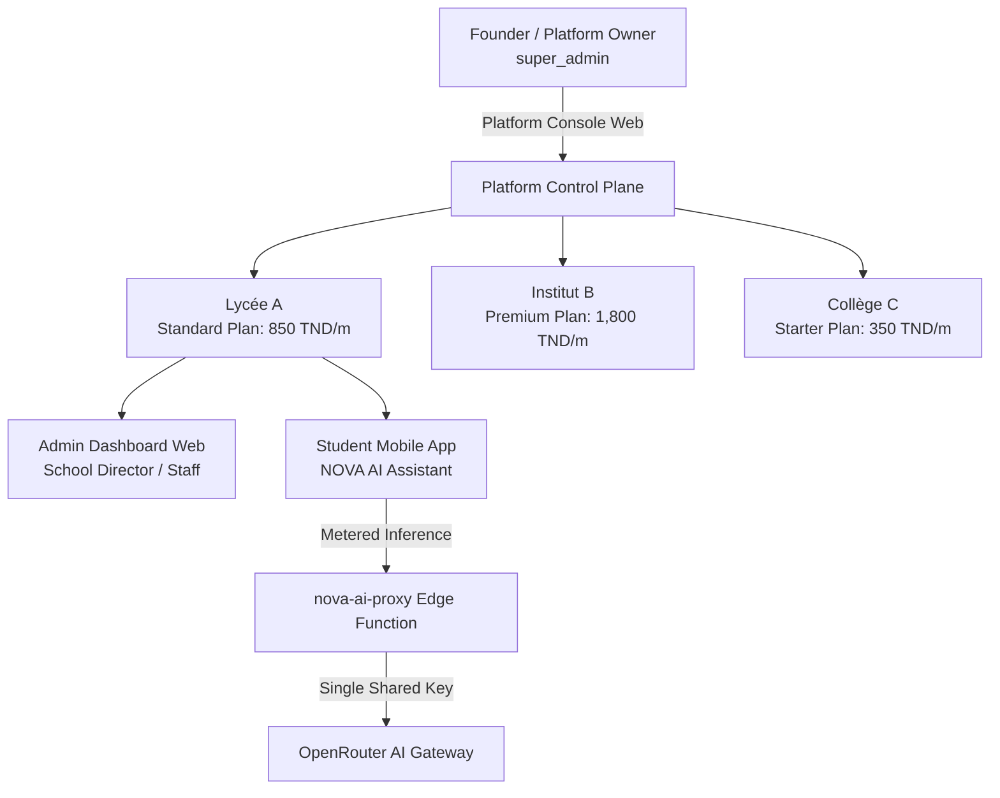
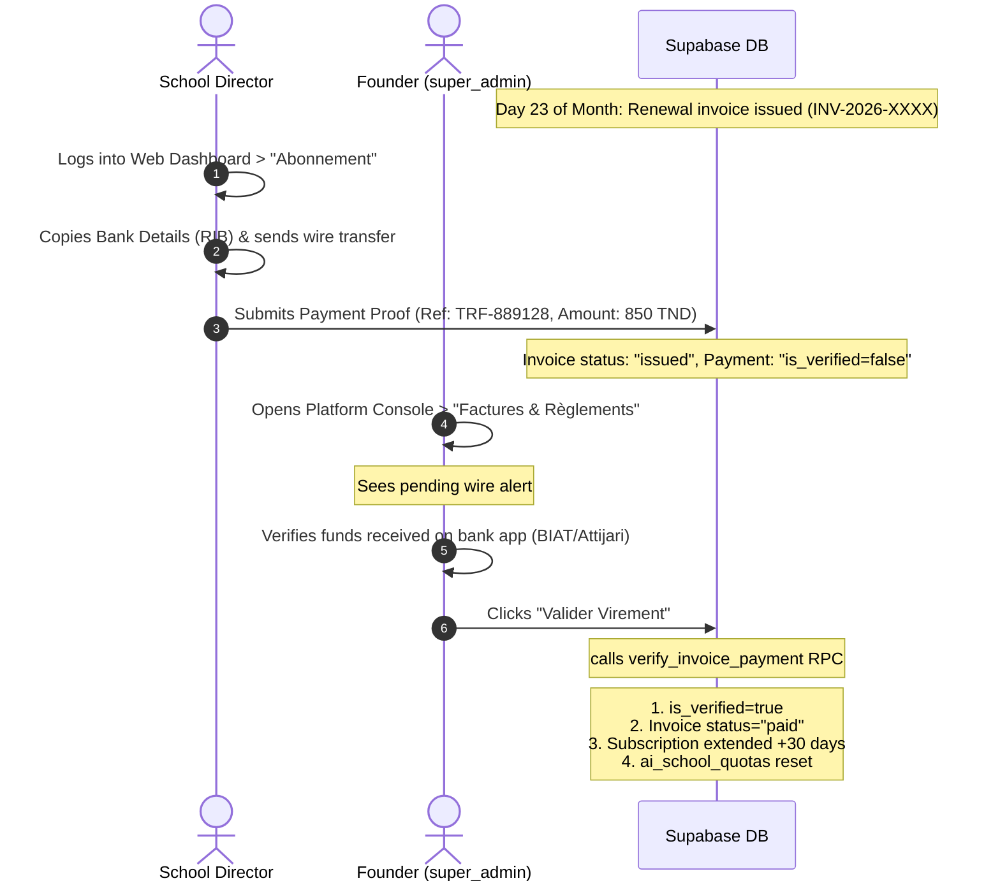

# Commercial Multi-Tenant SaaS Operations & Founder Playbook

> **Platform:** Pythagore SaaS (Platform Console + School Admin Dashboard + Student Portal Mobile)  
> **Target Audience:** Platform Founder & Solo Operator  
> **Status:** Production-Ready Multi-Tenant SaaS  
> **Version:** 2.0 (Commercial Architecture)  
> **Date:** October 2026  

---

## 1. Executive Summary & Business Architecture

The Pythagore platform operates as a B2B multi-tenant SaaS tailored for educational institutions (schools, high schools, universities, training centers).



### Commercial Principles
1. **You sell software subscriptions directly to schools.** Each school pays you monthly or annually in TND (Tunisian Dinar) or EUR.
2. **Each school receives:**
   - Its own isolated Web Admin Dashboard (`admin_dashboard/`) for directors, managers, and teachers.
   - The Student Mobile App (`studentportal01/`) branded with the school's logo and identity.
3. **Each student receives:**
   - A private AI educational assistant (**NOVA**) that only sees their personal academic data (grades, timetables, absences).
4. **AI cost is budgeted and metered server-side.** You pay OpenRouter centrally. The proxy ensures no student or school exceeds their daily or monthly budget, maintaining **gross profit margins above 88%–92%**.

---

## 2. Deployment Runbook

### Step 2.1: Apply PostgreSQL Migrations in Supabase
Execute the migrations in sequential order using the Supabase SQL Editor:

1. **`040_multi_tenant_security_core.sql`**
   - Propagates `school_id` across all 14 tenant tables with B-tree indexes.
   - Installs safe `SECURITY DEFINER` helper functions (`get_user_school_id()`, `get_user_role()`, `is_super_admin()`, `is_school_admin()`).
   - Configures automatic `school_id` triggers and append-only `audit_logs`.
   - Enforces strict multi-tenant Row Level Security (RLS) isolation.

2. **`041_ai_proxy_and_telemetry.sql`**
   - Creates `platform_settings`, `ai_school_quotas`, and `ai_usage_logs`.
   - Installs RPCs: `record_ai_usage` and `check_student_daily_ai_limit`.

3. **`042_subscriptions_and_invoicing.sql`**
   - Creates `subscription_plans`, `school_subscriptions`, `invoices`, and `invoice_payments`.
   - Seeds Starter (350 TND), Standard (850 TND), and Premium (1,800 TND) plans.
   - Backfills active 30-day trials for existing schools.
   - Installs automatic payment verification and subscription extension RPCs.

4. **`099_demo_school_seed.sql`** (Optional — Pitch & Demo)
   - Creates `Lycée Pilote Pythagore (Démo)` with code `demo`, pre-filled with sample classes, invoices, and AI telemetry.

---

### Step 2.2: Deploy Serverless Edge Functions
From your terminal, deploy the 3 mission-critical Edge Functions:

```bash
# 1. User Management (Privileged user creation without exposing service_role key)
supabase functions deploy manage-users --project-ref cazuauxivrboygehrkij

# 2. Secure NOVA AI Proxy & Token Metering Gateway
supabase functions deploy nova-ai-proxy --project-ref cazuauxivrboygehrkij

# 3. Scheduled Billing & Subscription Lifecycle Enforcement
supabase functions deploy billing-enforcement --project-ref cazuauxivrboygehrkij
```

#### Set Edge Function Secrets:
```bash
supabase secrets set OPENROUTER_API_KEY="sk-or-v1-YOUR_OPENROUTER_KEY" --project-ref cazuauxivrboygehrkij
```

*(Note: If deploying via the Supabase Web Dashboard, simply copy the contents of `index.ts` into each function in **Edge Functions** > **Create Function**, and set `OPENROUTER_API_KEY` in **Project Settings** > **Edge Functions** > **Secrets**).*

---

## 3. Commercial Tiers, Pricing & Margin Economics

### 3.1 Unit Cost to Serve (COGS) Breakdown

| Item | Monthly Consumption per Student | Cost in USD | Cost in TND |
| :--- | :--- | :--- | :--- |
| **NOVA AI Tokens** (Laguna / Flash) | 50 queries ≈ 75,000 tokens | \$0.015 | ~0.047 TND |
| **Supabase Database & Auth** | Pro Plan spread over 1,000 students | \$0.025 | ~0.078 TND |
| **Cloudflare & Edge Functions** | 100,000 invocations | \$0.005 | ~0.015 TND |
| **Total COGS per Student / Month** | — | **\$0.045** | **~0.14 TND** |

---

### 3.2 Subscription Plans & Profitability Matrix

| Plan Tier | School Size Capacity | Included AI Limits | Monthly Price (Tunisia) | Annual Price (Tunisia) | Monthly Price (International) | Est. COGS | Net Profit Margin |
| :--- | :--- | :--- | :--- | :--- | :--- | :--- | :--- |
| **Starter** | Up to 200 students | 30 msgs/student/day<br/>5M tokens/school | **350 TND / m** | 3,500 TND / yr | **110 € / m** | ~28 TND | **92.0%** |
| **Standard** *(Best Value)* | Up to 600 students | 60 msgs/student/day<br/>15M tokens/school<br/>School Logo Branding | **850 TND / m** | 8,500 TND / yr | **260 € / m** | ~84 TND | **90.1%** |
| **Premium** | Up to 1,500 students | 120 msgs/student/day<br/>50M tokens/school<br/>Custom Theme & Priority SLA | **1,800 TND / m** | 18,000 TND / yr | **550 € / m** | ~210 TND | **88.3%** |

---

## 4. Multi-Tenant Onboarding Procedure (SOP)

Onboarding a new client school takes less than **3 minutes** directly from the **Console Fondateur**:

1. Log into `admin_dashboard/` with your `super_admin` account.
2. Click **Console Fondateur** in the sidebar (accessible only to `super_admin`).
3. Navigate to the **Établissements** tab and click **Ajouter une École**:
   - **Nom de l'établissement:** e.g. `École Privée El Manar`
   - **Code École:** e.g. `elmanar` (used as school identifier)
   - **Email Contact:** `contact@elmanar.tn`
   - **Directeur - Nom:** `Mounir Trabelsi`
   - **Directeur - Email:** `mounir@elmanar.tn`
   - **Mot de passe initial:** `Elmanar2026!`
   - **Formule d'abonnement:** Standard (850 TND/m)
4. Click **Créer l'Établissement**.
5. **System Automation:**
   - Creates the school record in `schools`.
   - Allocates the AI budget in `ai_school_quotas`.
   - Attaches the active subscription in `school_subscriptions`.
   - Creates the school director in Supabase Auth and `public.users` with role `owner`.
6. Send the credentials to the school director:
   - Web URL: `https://your-dashboard-domain.web.app`
   - Login: `mounir@elmanar.tn` / `Elmanar2026!`

---

## 5. Billing, Invoicing & Payment Collection

### 5.1 Payment Workflow in Tunisia
Because most Tunisian B2B schools pay via **Virement Bancaire (Bank Transfer)**, **Chèque**, or **D17**:



---

## 6. AI Cost Control & Emergency Controls

### 6.1 Multi-Model Fallback
The `nova-ai-proxy` Edge function automatically falls back through configured models to guarantee 99.9% uptime at the lowest possible cost:
1. Primary: `poolside/laguna-s-2.1:free` (Fast, high-quality, free)
2. Fallback 1: `google/gemini-2.0-flash-exp:free` (Comprehensive multimodal, free)
3. Fallback 2: `openai/gpt-4o-mini` (Ultra-low cost commercial fallback: \$0.15/1M tokens)

### 6.2 Emergency Kill-Switch
If a school's students engage in abusive automated scraping or an API anomaly occurs:
- **Global Kill-Switch:** Toggle in the **Console Fondateur** under **Télémétrie IA**. Instantly cuts off OpenRouter access across all schools without taking down the admin dashboard.
- **Per-School Kill-Switch:** Suspend or toggle the quota for an individual school.

---

## 7. Security & Compliance Checklist

- [x] **Zero Secrets in Client Binaries:** Neither the `service_role` key nor the `OPENROUTER_API_KEY` are embedded in Flutter Web or Flutter Mobile builds.
- [x] **Strict RLS Tenant Isolation:** Every SQL query is filtered by `school_id = get_user_school_id()`. No school can see another school's students, teachers, grades, or timetable.
- [x] **Automated Audit Logging:** High-privilege actions (grades changes, payments, user additions) are recorded in the immutable `audit_logs` table.
- [x] **Tunisian Minor Privacy Compliance:** Student AI interactions do not leak personal identifiers (CIN, home address) to external model providers. Prompts are sanitized with operational boundary wrappers.
